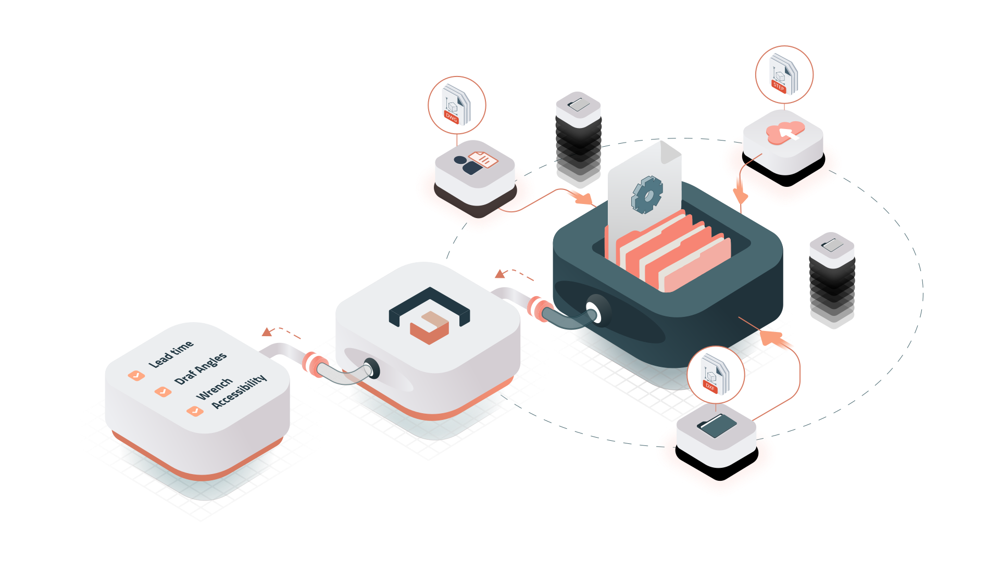

# Floating Gates 
 
Gates provide software layer for factories to pick up design errors in engineering docs before they get produced or discussed.

<div align="center">
  
</div>

### What is the problem is solving?

Traditional design reviews fail to identify approximately 20% of engineering defects. These oversights come at a high cost, as they result in excessive tolerances, material waste, rework during production, and field failures. The same problem, though more subtle yet even more serious, can be defined as the human inability to adhere to manufacturing standards in accordance with the “good old” design guidelines.

## Products:

#### Good2Manufacture

As automated network software that serves as a standalone quality control system for mechanical design projects. It functions as a digital error-checking system, operating 24 hours a day, 7 days a week, to ensure internal compliance with Design for Manufacturing (DFM) standards enforceable on all stakeholders.

It perform CAD and GD&T autonomous revision revision to spot manufacturing issues ahead. Every cad files in the network, encounter a checkpoints by which is either green lit or highlighted for revision.

A human in the loop is required once an issue is found.

### Components

Good2Manufacture is a software composed of two layers:

- a Manufacturing Agent ( i.e. it acts in the background for you)  
- a public-facing Huckster interface. 

Briefly, the Agent checks the manufacturability and return reports on the health status of the CAD library in your company network. While the MDB interface is provided to guide and insight both external Customers and Employees towards the product they want, assessing what the machines can reasonably produce.

## For who is made

**Gates** serves mainly the following production environments:

- Large manufacturing lines (e.g. plastic injection facilities, CNC shops).
- Small workshops and independent makers with a single 3D printer.

It is especially beneficial for companies who interact a lot with third party actors to communicate manufacturing documents.

## Documentation

Content is written as Markdown in [`src/data/docs/`](src/data/docs/), one file per chapter, with
[`src/data/docs/SUMMARY.md`](src/data/docs/SUMMARY.md) declaring the order and nesting. 

See [`src/docs/README.md`](src/docs/README.md) for how to add a chapter.

## Building and Deploying

You can build and deploy the landing page for development, staging, or production using the following commands:

### Build Environments

Configure your environment variables inside the appropriate `.env.[mode].local` files prior to building.

```shell
# Local/Development Build (Reads .env.development.local)
npm run build-local

# Staging Build (Reads .env.staging.local)
npm run build-staging

# Production Build (Reads .env.production.local)
npm run build-production
```

An example of ```.env.development.local```

``` shell
VITE_DEMO_URL=http://demo.localhost
VITE_APP_URL=http://app.localhost/login
VITE_PARTNER_APP_URL=http://app.localhost/referral-login
VITE_API_URL=http://app.localhost/api
```

### Deployment

Deployments utilize the configured targets inside the `Makefile` and automate file transfer via `rsync`.

```shell
# Deploy to Local test server
npm run deploy-local

# Deploy to Staging environment (includes pre-deploy remote backup)
npm run deploy-staging

# Deploy to Production environment (requires confirmation, includes backup)
npm run deploy-production
```

