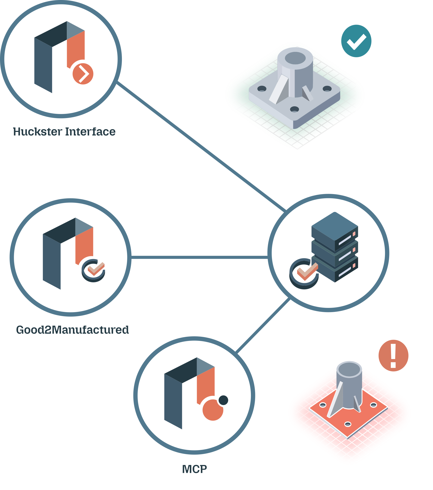

## Core components

Gates uses automated feasibility checks and rule-based evaluation to identify manufacturing flaws before production begins on the shop floor.

### DfM Rules Check

Every CAD design is evaluated against a central Design Playbook containing your custom Design for Manufacturability (DfM) rules, engineering constraints, tolerances, and standardized practices. The playbook is defined once and applied consistently across all incoming files.

### CAD as a Graph Analysis

Gates maps individual manufacturing features and their spatial relationships into an attributed graph. This structural model detects complex issues standard CAD viewers miss, such as undercuts unreachable by 3-axis tools, thin wall boundaries, or invalid clamping surfaces.

###  In-Network Execution

Gates operates entirely within your existing infrastructure behind your corporate firewall. Geometry is analyzed at its source, guaranteeing your intellectual property never leaves your environment.

---

## Factory Configuration & Deployment Surfaces

You configure your factory parameters once. Because quoting and DfM validation pull from the same underlying configuration model, feasibility checks and generated quotes never disagree.

| Surface | Environment | Primary Function |
| --- | --- | --- |
| Good2Manufacture Server | Linux host behind your firewall | Evaluates CAD and GD&T against your Design Playbook and drafts quotes from the same factory configuration. |
| Good2Manufacture Client | Windows, Linux, or macOS endpoint | Watches the local CAD library and presents the latest revision to the server on port 9997. |
| Huckster Interface | your-name.floating-gates.com | Public web UI where suppliers, customers, and employees submit files and see whether a part can be produced. |
| AI Connect | An AI Frontier Lab | Lets Claude, Mistral, or OpenAI agents run the same factory checks through a standard connector. |
| Manufacturing Hub | app.floating-gates.com | Configure factory parameters, inspect scan results, review incoming orders, and set final pricing. |
