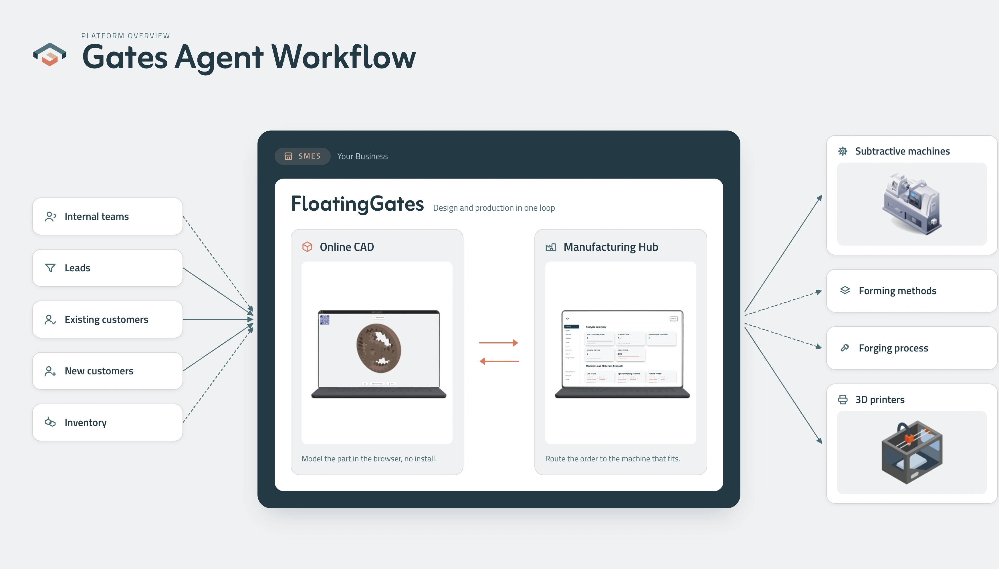

The Economics module is what allows the factory to "understand" the cost of the device: every request that enters the system is translated into concrete, rule-based costs before any material is cut. This page explains how incoming requests are routed through that cost recognition pipeline.

Requests originate from internal teams, leads, existing clients, or inventory requirements. The Huckster Interface and the Manufacturing Hub coordinate to validate each submission, estimate its resource consumption (material, machine time, finish work), and assign it to the appropriate manufacturing process: subtractive, forming, forging, or additive. At this point the device exists only as CAD data; the Economics module is what turns that geometry into a priced, auditable cost breakdown.

### Deterministic Pricing Model

Gates prices every request using rules derived directly from your setup in the Economics module. Because each cost driver is configured explicitly, every line item on a quote is fully audit-traceable back to a setting in this module.

| Quote Line Item | Source in the Economics Module |
| --- | --- |
| Material Cost | Volume (cm³) × material unit cost |
| Machining Time | Estimated run time × machine hourly rate |
| Tolerance Adjustment | Configured tolerance surcharge matrix |
| Surface Finish | Configured surface finish cost table |
| Quantity Discount | Applied volume discount tiers |
| Delivery Adjustment | Urgency and lead time surcharges |
| Setup Fee | Standard setup cost for selected machine |
| Price Per Unit / Total | Sum of line items multiplied by order quantity |

In other words, if you want the factory to recognize a new cost of the device (a new material, a pricier machine, a tighter tolerance), you define it here, and Gates will apply it automatically and consistently across every quote.

> **Note:** Automatically generated quotes serve as draft proposals. Operators review and approve all quotes before they are finalized for the customer.
