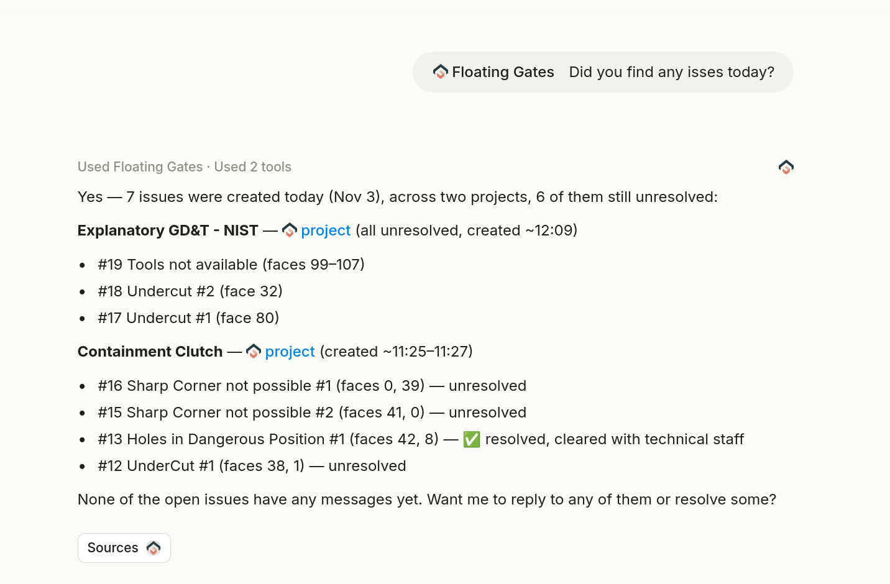

AI Connect is the Model Context Protocol (MCP) server for Gates. It exposes your factory checks as tools that an LLM can call, so an agent fleet can drive Good2Manufacture the same way a person uses the Huckster Interface.

Instead of writing custom glue for each model, you register one connector. The agent then discovers the available tools, asks for the current CAD and GD&T context, and runs manufacturability checks before it proposes a change or a quote.

## What it is for

- Let Claude, Mistral, or OpenAI agents inspect files that the Good2Manufacture clients have already fetched
- Run the same DfM playbook the rest of Gates uses, so an agent cannot green-light a part the factory cannot make
- Keep credentials and tool execution behind your existing Gates API key

## Compatible AI labs

AI Connect follows the MCP specification, so any client that can add a custom connector can use it. The labs exercised in this documentation are Claude, Mistral, and OpenAI.

Tool schemas and resource capabilities are validated live during interaction, so the agent acts on current factory context rather than a stale copy of the files.

To attach the connector to a lab, continue to the next chapter.

## What you need

- A Gates API key from the [Licence and API Key page](https://app.floating-gates.com/profile)
- At least one Good2Manufacture server with a reachable client, so the agent has files to inspect
- An MCP-capable client at Claude, Mistral, OpenAI, or another lab that accepts custom connectors
