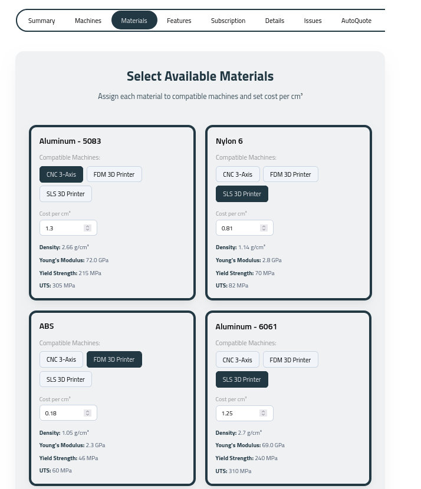

# Documentation content

Everything shown at `/docs` lives here as **Markdown**. One `.md` file per
chapter, plus [`SUMMARY.md`](./SUMMARY.md), which declares the order and the
nesting.

The content was migrated from <https://floating-gates.gitbook.io/gates-docs>,
and the chapter order mirrors it.

## Adding a chapter

Create a Markdown file:

```md
---
id: quoting
title: Quoting
description: How pricing works
---

Quotes are produced from geometry and material.

## Automatic quotes


Use `**bold**`, `*italic*`, lists, tables, and fenced code as usual.
```

Then add it to [`SUMMARY.md`](./SUMMARY.md) in the right place:

```md
- [Quick Start](quick-start.md)
  - [Quoting](quoting.md)
```

`SUMMARY.md` is what creates sidebar nesting. A chapter with no indent is
listed on its own. Slugs are composed from the tree, so `quoting.md` nested
under `quick-start.md` is served at `/docs#quick-start/quoting` without having
to write that path anywhere.

`id` becomes the URL segment. If you omit it, the filename is used. `title` is
the sidebar label and page heading. `description` is the optional subtitle.

You can also skip frontmatter and start the file with `# Title`. That heading
becomes the page title and is not repeated in the body.

## What you can write

Standard Markdown. The page title is already rendered from the frontmatter, so
chapter headings start at `##`.

| Markdown | Result |
| --- | --- |
| `## Heading` / `### Heading` | Headings. `##` and `###` appear in the "On this page" rail. |
| paragraphs | Regular text. |
| `-` / `1.` lists | Bullet and numbered lists. Indent to nest. |
| ` ```lang ` | Fenced code, rendered verbatim. |
| `` | Centred screenshot with the caption underneath. |
| `` | Full-width figure. |
| `> note` | Callout / aside. |
| tables | GitHub-style tables, including `:---:` alignment. |
| `---` | Horizontal rule. |

Inside paragraphs, list items, quotes, captions and table cells you can use
`**bold**`, `*italic*`, `` `code` ``, `[links](url)`, ``, and
`~~strikethrough~~`. Everything is escaped, so raw HTML is shown as text rather
than injected.

## Page furniture

The left sidebar, the "On this page" rail, and the previous/next footer are all
generated from this data. The rail lists the level 2 and 3 headings of the
current chapter, and previous/next follows the same reading order as the
sidebar. Nothing to maintain by hand.

## Images

Screenshots live in [`src/data/images/docs-images/`](../images/docs-images/)
and are referenced with a path relative to the chapter file:

```md

```

Vite fingerprints the file at build time, so a typo fails the build instead of
silently serving a 404. Because the path is relative to the chapter file, the
image is also resolvable from the editor — hover the path to preview it, or
click through to the file.

## Checking your work

```sh
npm test                # renderer, parser, and table-of-contents tests
npm run build-local     # fails loudly if a chapter breaks the build
```

The parser is [`src/utils/markdown.js`](../../utils/markdown.js); the renderer
is [`src/utils/docs.js`](../../utils/docs.js); the component that lays the page
out is [`src/components/Docs.vue`](../../components/Docs.vue).
