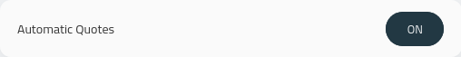
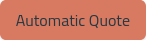
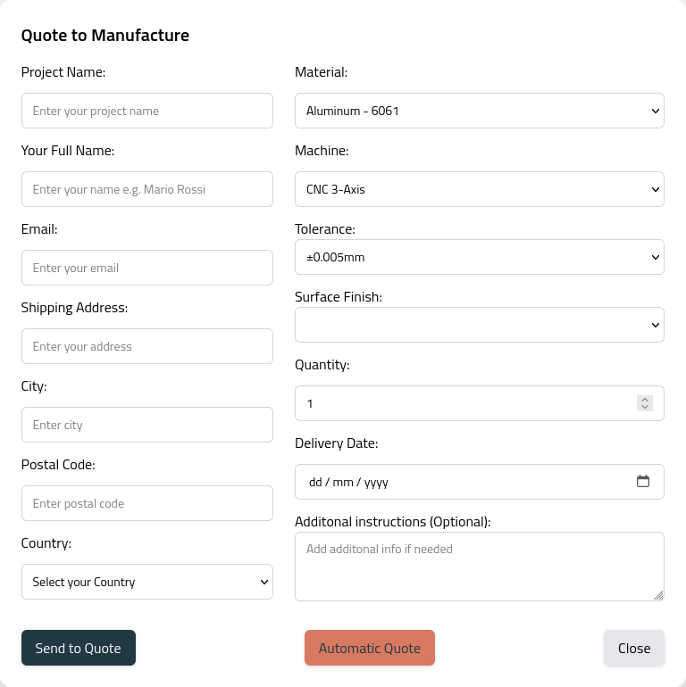
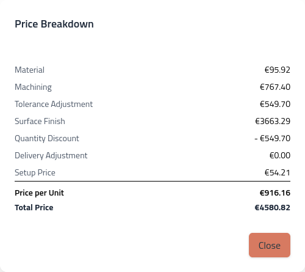

## Automatic Quote

Once it is activated:

your hub will show a specific button when your customers are about to quote:

Below is the location of the feature:

A usual output of the automatic quote is:

