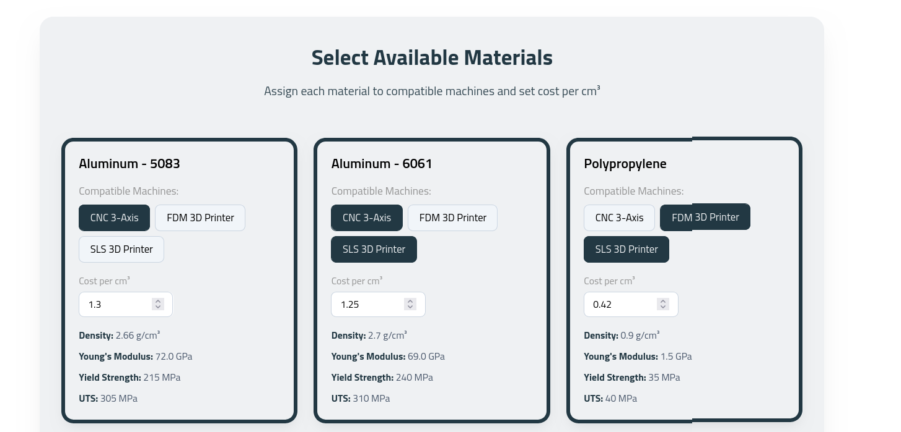
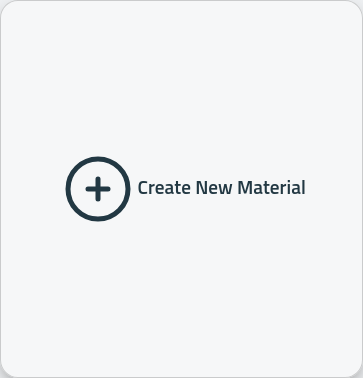
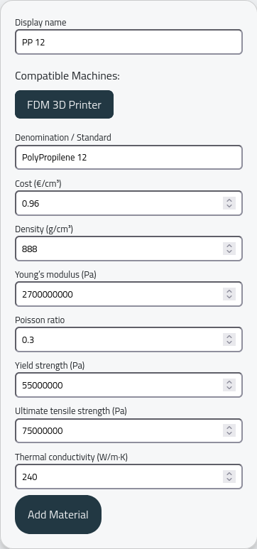

Materials need to be coupled with machines. Once a machine is selected as available it can be coupled with more than one material.

This is equivalent to saying:

- Use Aluminium 5083 with a CNC 3-axis
- Use Aluminium 6061 with a CNC 3-axis and an SLS 3D printer
- Use Polypropylene with an FDM 3D printer and an SLS 3D printer

Insert a new material:

