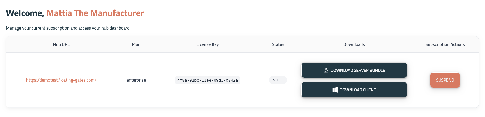

### Client Requirements

| Component | Specification |
| --- | --- |
| Required Package | good2manufactured |
| Operating System | Windows 10 or 11 (64-bit) |
| Network Connection | Stable broadband (5 Mbps minimum) |

---

## 1. Download the Software Bundle

Log into the [Admin Panel](https://app.floating-gates.com/dashboard?menu=Admin) to download the Enterprise stack archive and retrieve your license keys, which will be needed during initial setup.



## 2. Extract and Configure

Extract the downloaded archive and navigate into the stack directory:

```bash
tar -xzf floating-gates-enterprise-<version>.tar.gz
cd stack-structure
```

Next, create a `.env` file in the root directory to store runtime variables and license information:

```env
LICENCE_KEY=your-licence-key
ACCOUNT_EMAIL=your-email-account
PASSWD_EMAIL=email-account-password
SMTP_EMAIL_SERVER=your-mail-server
ENABLE_EMAIL=true

# Optional Stack Configuration
STACK_PORT=8000
DOMAIN_NAME=your-domain-name
SERVER_SUBDOMAIN=app
HOST_ADDR_GOOD2MANUFACTURED=169.254.1.2:9997
DEMO_URL=http://demo.your-domain/
```

## 3. Start the Stack

Run `start_gates.sh`. This script configures and launches the NGINX reverse proxy, webserver pod, and floating-gates application pod, then waits for all services to settle before confirming status.

```bash
./start_gates.sh
```

Example startup output:

```text
Configuring nginx-pod...
Configuring webserver...
Configuring floating-gates.pod...
Configuring config for good2manufactured...
Waiting for services to settle...
Verifying service status...
OK: floating-gates-pod is active.
OK: nginx-pod is active.
OK: webserver is active.
OK: good2manufactured is active.
Configuring backup script...
Configuring bundling script...
----------------------------------------------------
Deployment successful! The following ports are active:
 - Webserver: http://localhost:8000
 - HTTP Proxy: http://localhost:8080
----------------------------------------------------
You can check user systemd services at: ~/.config/systemd/user
Done!
```

## 4. Post-Installation Verification

Ensure all service status lines report `OK` before accessing the application. If services fail to reach an active status, check the logs via `journalctl --user -u floating-gates-pod` or your container runtime before attempting a restart.

To manually restart the stack service if needed, run:

```bash
systemctl --user restart floating-gates-pod
```
