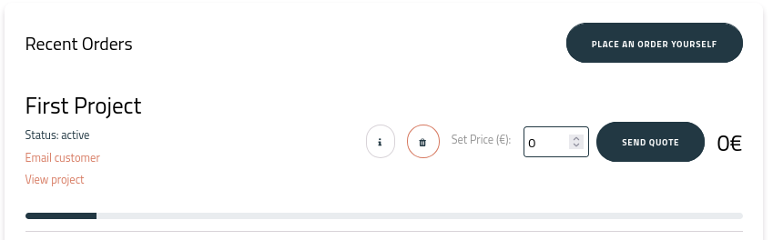
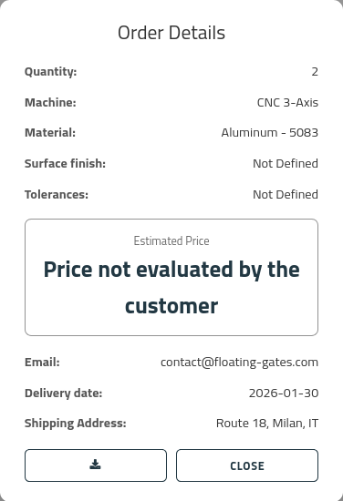
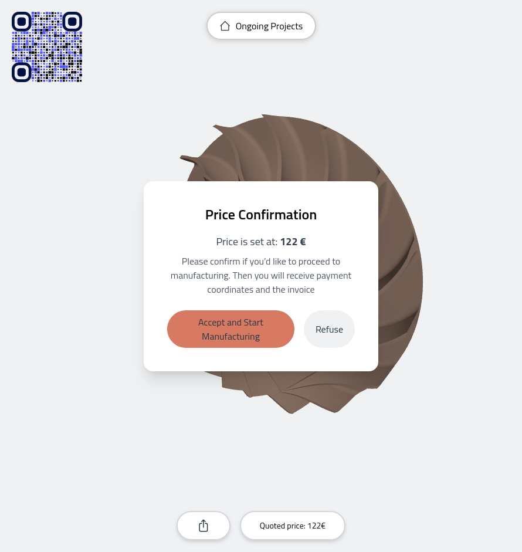
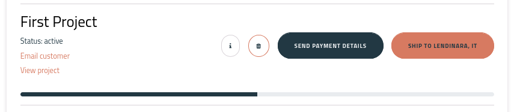

## Check the Dashboard

You will see that an order appears:

## Inspect the order

From the order you can download the device, inspect it, and produce a price for it:

## Set the price

Use the price input below and send the quote:

In the meantime the user has been sent an email with your formal offer, and they can accept or refuse it:

Once accepted:

From now on you can start manufacturing the device. Later, you can send the invoices and declare the shipment. Once you have declared the order shipped, it is considered closed.

Done, you have sold a propeller.
