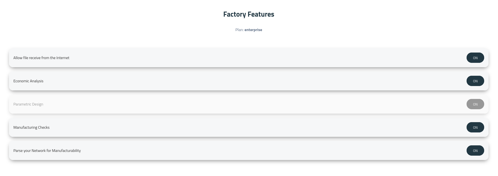

## Managing CAD Capabilities

Gates provides granular feature controls to streamline collaboration between manufacturers, internal engineering teams, and external customers. You can enable or disable specific CAD operations, inspection tools, and workflow permissions depending on user role.

To access and adjust these settings, navigate to the [Factory Features Panel](https://app.floating-gates.com/?menu=Factory+Features) in the Manufacturing Hub.

