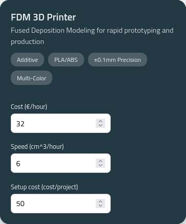
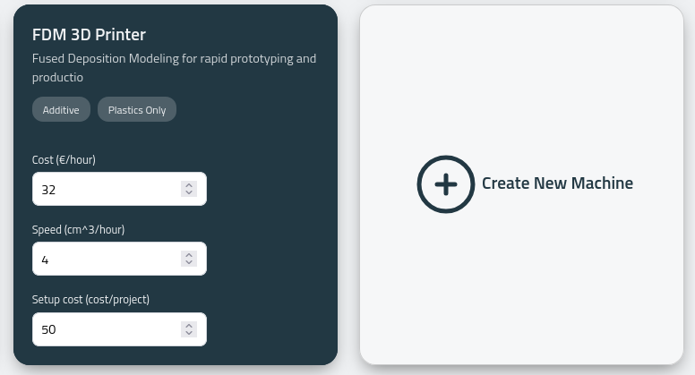
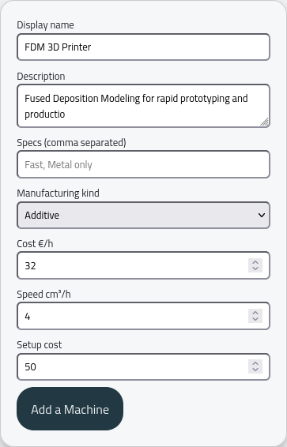

To pick a machine that is compatible with the automatic quotation function, you are asked to insert the cost factors necessary to calculate the price of an object:

Custom machines can be generated via:

Which results in:

