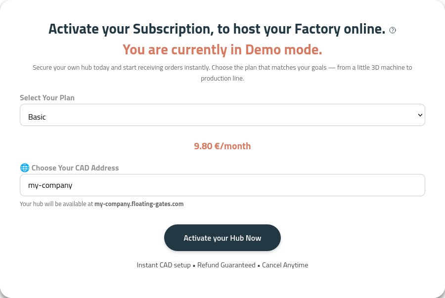
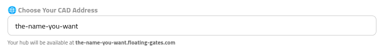
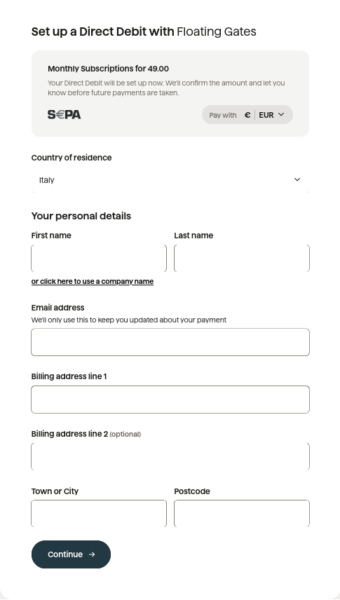
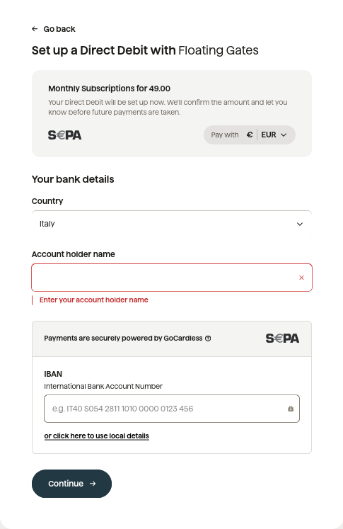

## Exit Demo mode and set up your Hub

If no actions are taken inside the platform, the only hub available to you is the demo at [demo.floating-gates.com](https://demo.floating-gates.com). From the demo you can see all the features that are available to consumers. However, to make your CAD available you need to follow the steps listed below:

## Select your URL

Once you have completed the transaction the hub will be immediately ready and you can start to operate in it.

## How direct debit is set up

Once you choose your selected plan you will be redirected to a page similar to the one below, managed by GoCardless:

Then you are asked to input the IBAN and account holder name.

Once the procedure is completed your CAD will be ready for the world to access.
