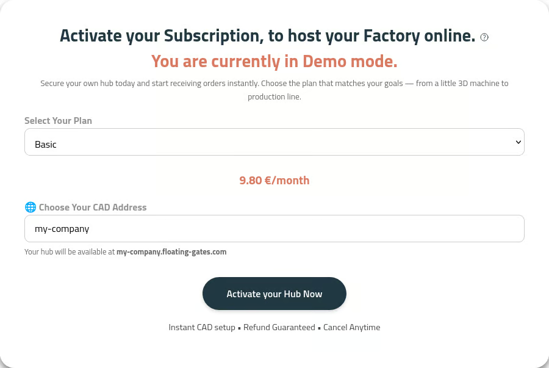

## Access Gates and go to the Dashboard

- Open your web browser and navigate to [floating-gates.com](https://floating-gates.com).
- Click on **Log In** from the homepage and register.

- You will then be redirected into the [Dashboard](https://floating-gates.com/dashboard).

## Choose your Hub address

Once logged in you will reach the dashboard, which asks you what kind of subscription plan you want and at what address you plan to host your client App:

Select the name of the hub and the plan you want based on the features you would like to use. The payment is held by GoCardless:

## What you can do as a Factory and as a Consumer

Gates separates what you can do and what a customer can do, as per below:

| Feature / Action | Factory | Customer |
| --- | :---: | :---: |
| Create Projects | No | Yes |
| Parametric Design Configuration | Yes | No |
| Machine Configuration | Yes | No |
| Material Set-up | Yes | No |
| Quotation Generation | No | Yes |
| Parametric Model Generation | No | Yes |
| Manufacturing Checks | Not yet available | Not yet available |
| Order Approval | Yes | No |
| Branding Customization | Yes | No |
