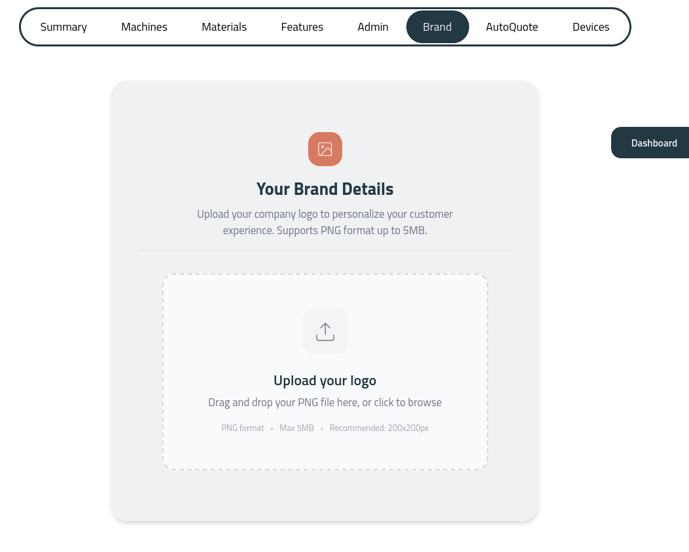
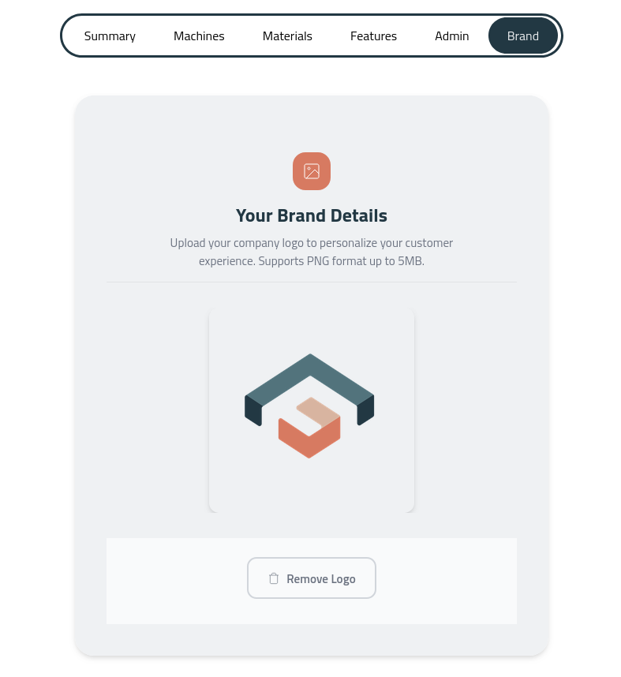
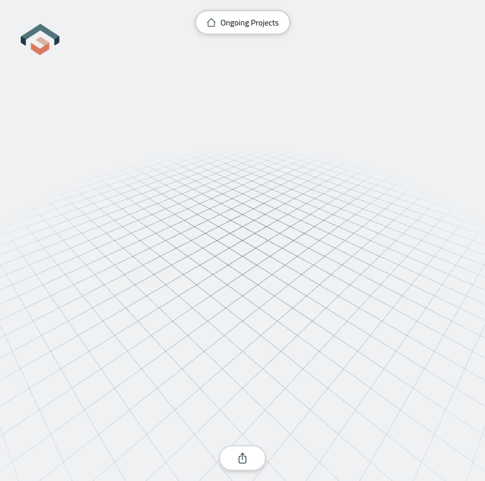

You can upload your logo at [floating-gates.com/profile](https://www.floating-gates.com/profile), in the following tab of the menu:

As an example, this logo was uploaded to the hub:

What you will see next is the presence of your brand in the online CAD at your specific address:

