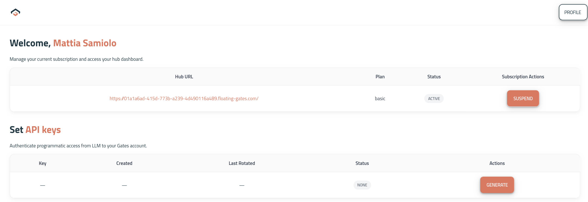
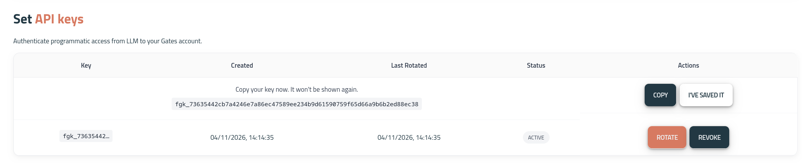
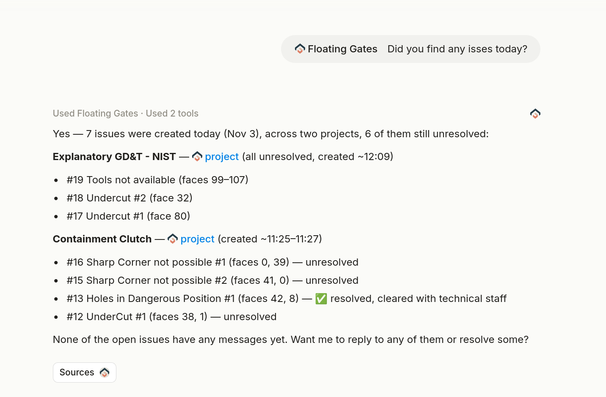

# Connect MCP to a top tier AI lab

As example It will be shown how to connect Gates for autonomous usage on [Mistral](https://console.mistral.ai/connectors).

## Generate API keys

Get your own API key from the [Licence and API Key page](https://app.floating-gates.com/profile)

Save on your computer your key:

## How to add a custom MCP

## Free to use your app from your agents

