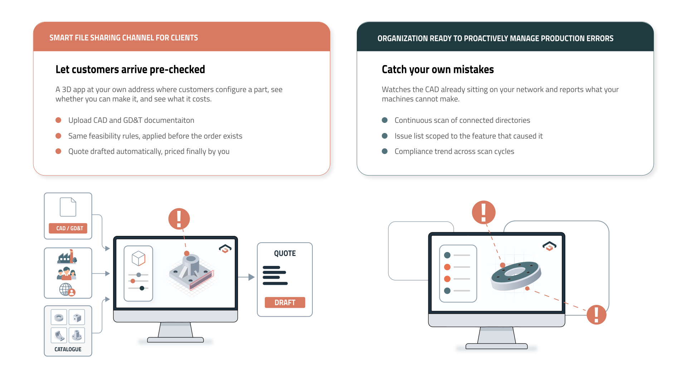
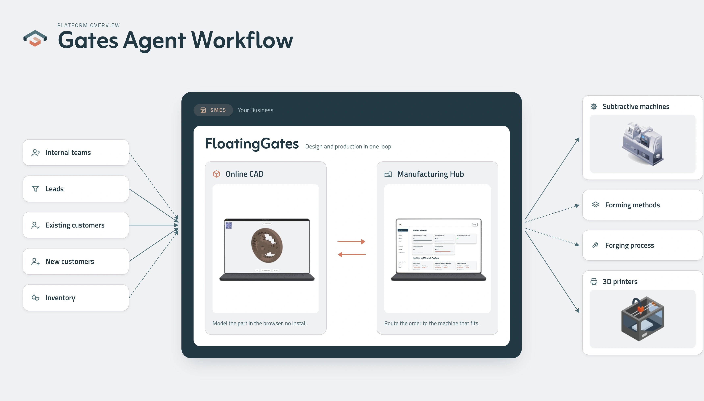

## How Gates Works

Gates uses automated feasibility checks and rule-based evaluation to identify manufacturing flaws before production begins on the shop floor.

### DfM Rules Check

Every CAD design is evaluated against a central Design Playbook containing your custom Design for Manufacturability (DfM) rules, engineering constraints, tolerances, and standardized practices. The playbook is defined once and applied consistently across all incoming files.

### CAD as a Graph Analysis

Gates maps individual manufacturing features and their spatial relationships into an attributed graph. This structural model detects complex issues standard CAD viewers miss, such as undercuts unreachable by 3-axis tools, thin wall boundaries, or invalid clamping surfaces.

###  In-Network Execution

Gates operates entirely within your existing infrastructure behind your corporate firewall. Geometry is analyzed at its source, guaranteeing your intellectual property never leaves your environment.

---

## Factory Configuration & Deployment Surfaces

You configure your factory parameters once. Because quoting and DfM validation pull from the same underlying configuration model, feasibility checks and generated quotes never disagree.

| Surface | Environment | Primary Function |
| --- | --- | --- |
| Manufacturing Hub | app.floating-gates.com | Configure factory parameters, inspect scan results, review incoming orders, and set final pricing. |
| good2manufactured agent | Windows Service (Local Machine) | Monitors the file system and routes STEP files through the DfM pipeline prior to production. |
| Online CAD | your-name.floating-gates.com | Web-based 3D workspace where internal teams configure parts, verify manufacturability, and view cost estimates. |

These surfaces sit at the center of the request funnel, routing incoming CAD data to the appropriate processing pipelines.

Requests originate from internal teams, leads, existing clients, or inventory requirements. Online CAD and the Manufacturing Hub coordinate to validate and price each submission, then route the job to the appropriate manufacturing process (subtractive, forming, forging, or additive).

### Deterministic Pricing Model

Gates uses rule-based pricing derived directly from your setup in the Economics module, ensuring every line item on a quote is fully audit-traceable.

| Quote Line Item | Source Calculation |
| --- | --- |
| Material Cost | Volume (cm³) × material unit cost |
| Machining Time | Estimated run time × machine hourly rate |
| Tolerance Adjustment | Configured tolerance surcharge matrix |
| Surface Finish | Configured surface finish cost table |
| Quantity Discount | Applied volume discount tiers |
| Delivery Adjustment | Urgency and lead time surcharges |
| Setup Fee | Standard setup cost for selected machine |
| Price Per Unit / Total | Sum of line items multiplied by order quantity |

Note: Automatically generated quotes serve as draft proposals. Operators review and approve all quotes before they are finalized for the customer.
