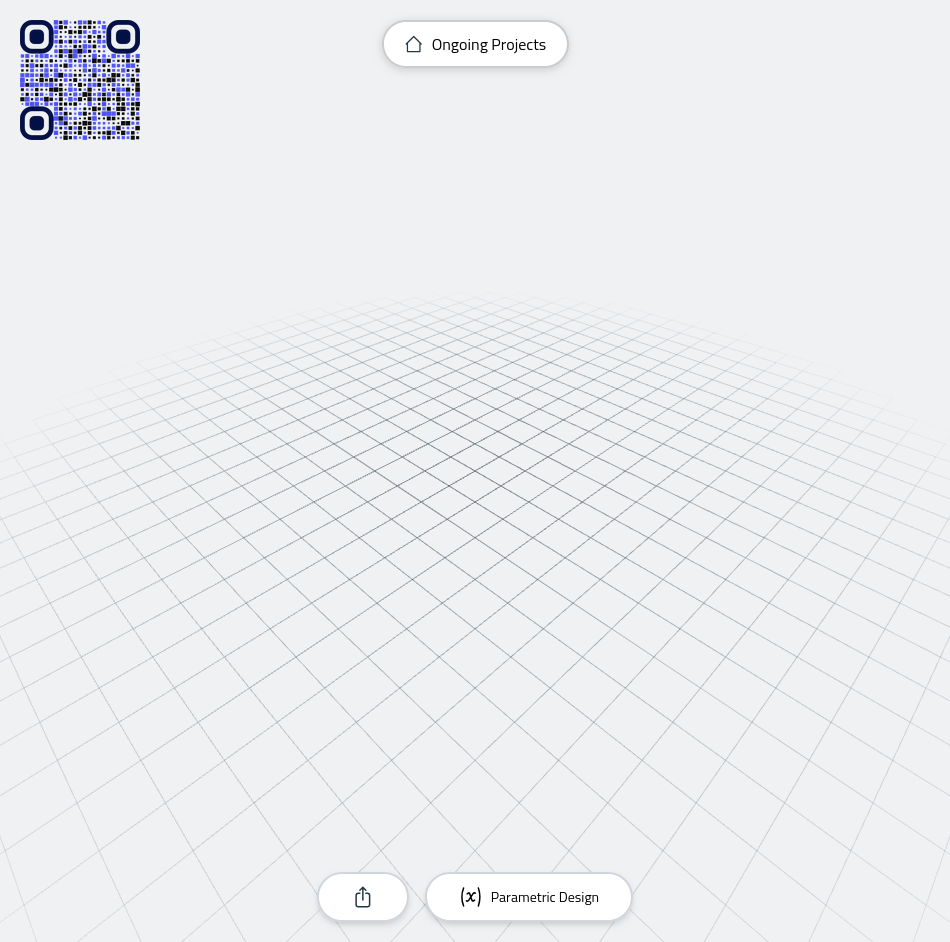
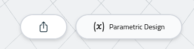
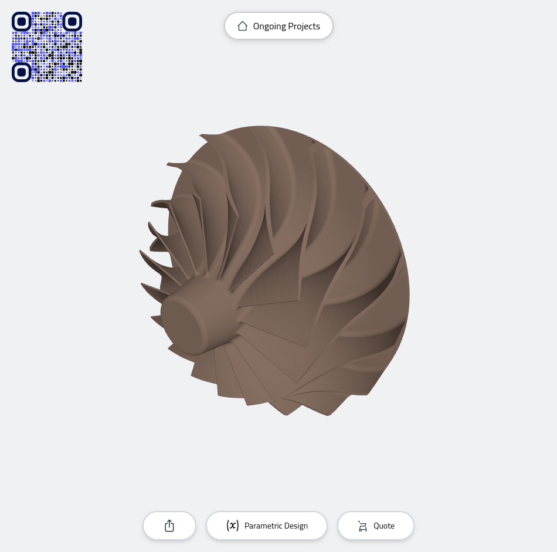
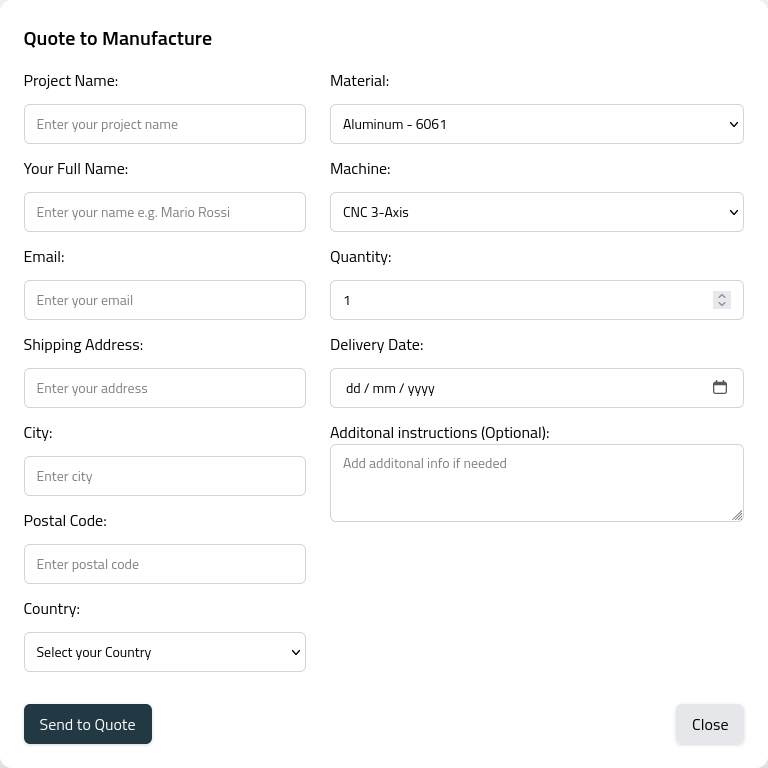

This walkthrough takes you through your first project end to end: opening a project, loading a device, and sending it off for a quote. Along the way you'll use the two main surfaces of Gates, the project workspace and the quote launcher.

After creating a new project, you will be redirected to your CAD interface:

### 1. Load a Device

Load a device using one of the available loaders. You have two options:

- **Parametric design (right):** if you have set up a parametric model, you can instantiate it directly and adapt its parameters to your needs.
- **General uploader (left):** upload a CAD model of your own, in any of the supported formats.

Once you have loaded a device, you can proceed to launching a quote:

### 2. Launch a Quote

Click the quote button, which will bring you to the following selections:

Here you define how the device should be manufactured:

1. **Machine type:** choose the manufacturing process (e.g. FDM 3D printer, CNC, or injection molding).
2. **Material:** select the material to use (e.g. Aluminium 6061 or Nylon 6).
3. **Details:** fill in the remaining options, such as tolerance, surface finish, and quantity.

Click **Send to Quote** to submit the request. Gates will validate the submission and generate a draft quote according to the rules configured in the Economics module, which an operator will review before it is finalized.
