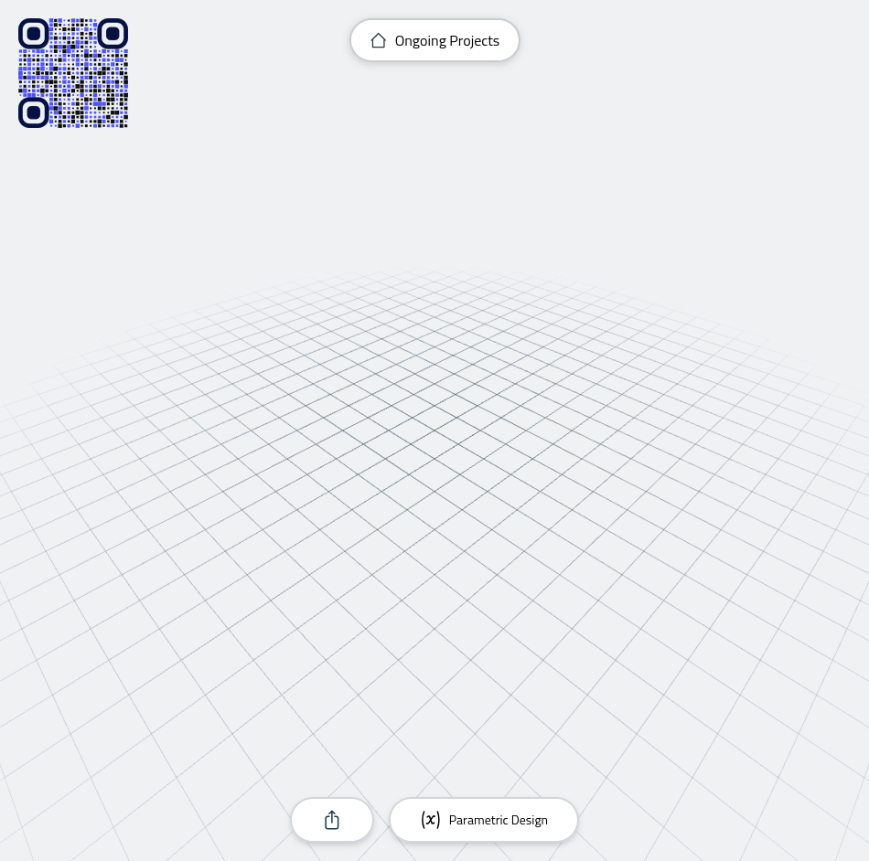
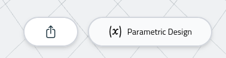
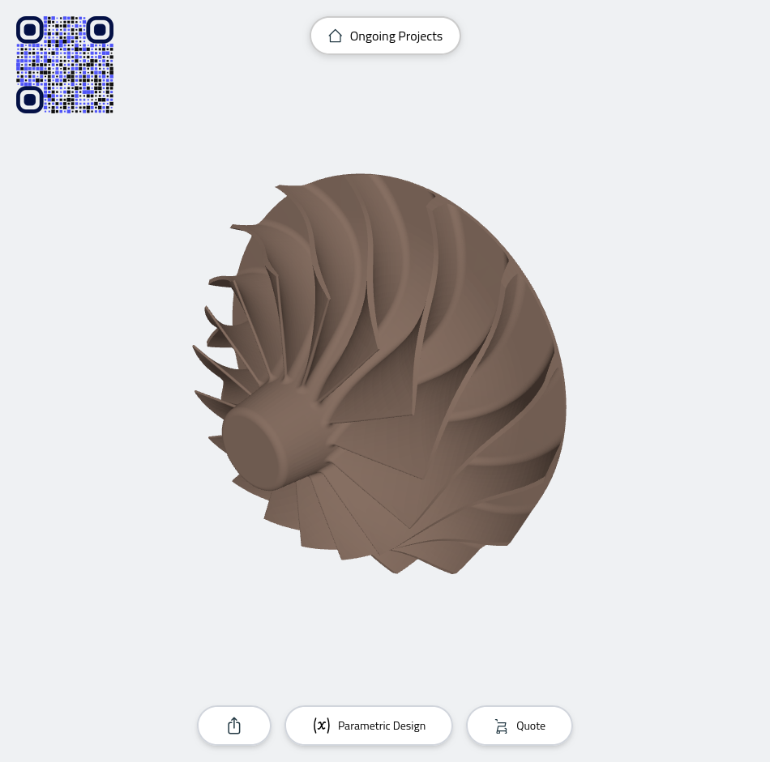
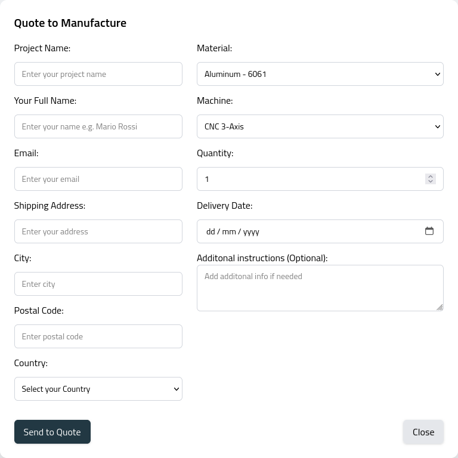

Click **Place an Order Yourself** on the Dashboard for internal project creation:

You will then be redirected to your CAD interface:

Load a device using one of the available loaders. If you have set up a model you can directly create a parametric design (right), or you can upload a model of your own with the general uploader (left):

Once you have loaded a device you can proceed to launching a quote:

Using the corresponding button, which will bring you to the following selections:

Choose your desired machine type (e.g. FDM 3D printer, CNC, or injection molding) and select a material (e.g. Aluminium 6061 or Nylon 6). Fill in the other details and click **Send to Quote**.
