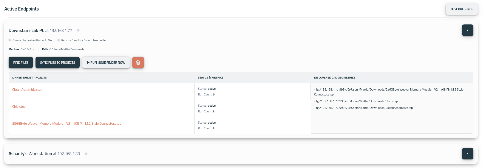

Good2Manufacture Client (`good2manufactured`) runs on the machines that actually hold your CAD library. It opens a secure channel to the Good2Manufacture server and acts as a file fetcher, so the server always sees the latest files and the latest revision.

A server without clients cannot see factory files. A client without a server cannot evaluate them.

The agent listens on port **9997**. You point the [Endpoints Manager](https://app.floating-gates.com/?menu=Endpoints) at the IP of the machine and at the root directory that contains the CAD you want checked.

> You have to set the IP address and the root directory to start a communication.

## What it does

- Watches the directory you register and presents the current CAD and GD&T revisions to the server
- Stays on the endpoint, so geometry is read at its source and does not have to be copied into a shared drive
- Reports reachability back to the Manufacturing Hub so you can see which shop-floor PCs are online

## Supported operating systems

| Platform | Package | How it runs |
| --- | --- | --- |
| Windows 10/11 x64 | `good2manufactured.exe` | Windows service |
| Linux x64 | `good2manufactured` | Foreground process or systemd unit |
| macOS 12+ | `good2manufactured` | Foreground process or launchd job |

Install steps for each platform are in the chapters that follow. You can also start from [Install Good2Manufacture Client](#what-is-gates/install-client).
