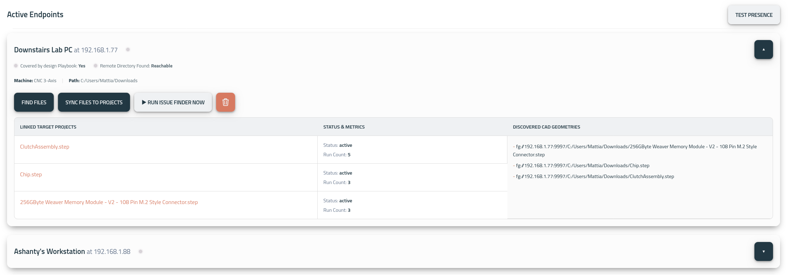

# Good2Manufactured ( the client )

Good2manufactured access your PC in a secure way and speak to the server. It will act as a file fetcher to permit to have always the latest files and latest revision parsed by the server.

To check if the communication is up and healthy you can check via: [Endpoints Manager](https://app.floating-gates.com/?menu=Endpoints) 

> N.B. You have to set the IP address and the root directory to start a communication.
