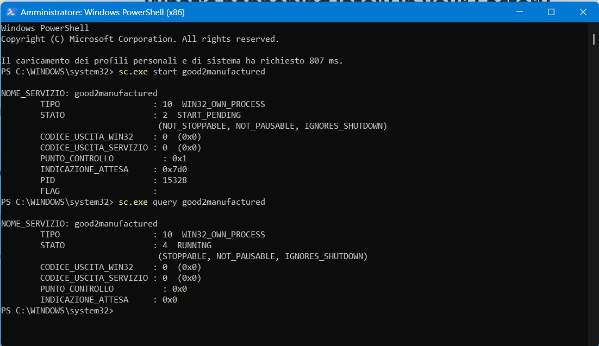

Open up the PowerShell using Administative permission and exequte the following queries:

```sh
./sc.exe query good2manufactured
./sc.exe stop good2manufactured
./sc.exe start good2manufactured
```

Like below:


