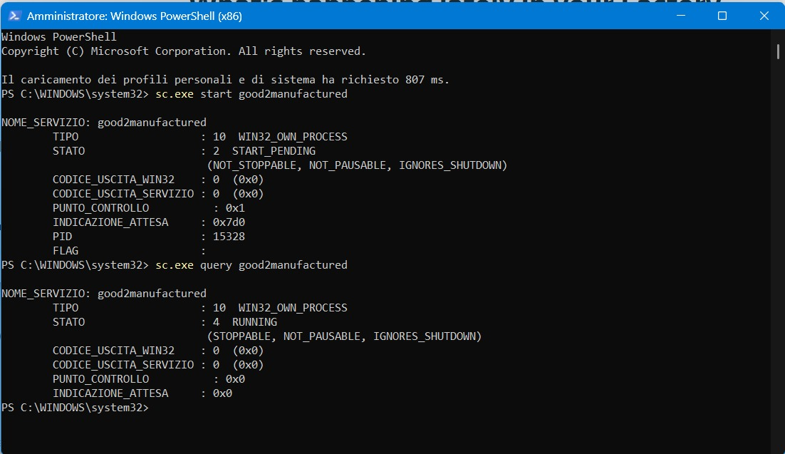

On Windows the client is `good2manufactured.exe`. Download it from the [Admin Panel](https://app.floating-gates.com/dashboard?menu=Admin) or the [Good2Manufacture download page](https://floating-gates.com/good2manufacture), then allow inbound TCP **9997** in Windows Defender Firewall so the server can talk to this PC.

## Run as a service

Open PowerShell with Administrative permission and use `sc.exe` to query, stop, or start the service:

```sh
./sc.exe query good2manufactured
./sc.exe stop good2manufactured
./sc.exe start good2manufactured
```

Like below:



## Register the endpoint

Open [Endpoint Setup](https://app.floating-gates.com/?menu=Endpoints), enter the IP of this computer, and set the root directory that holds the CAD library.

You should reach this scenario:


If you start the binary in the foreground first, the standard output looks like this:

```sh
Server listening on port 9997 (UNIX Mode)...
[CODE 4] Checking library presence at: C:\CAD
```
