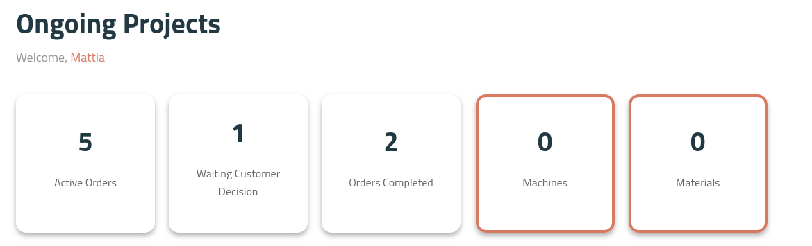
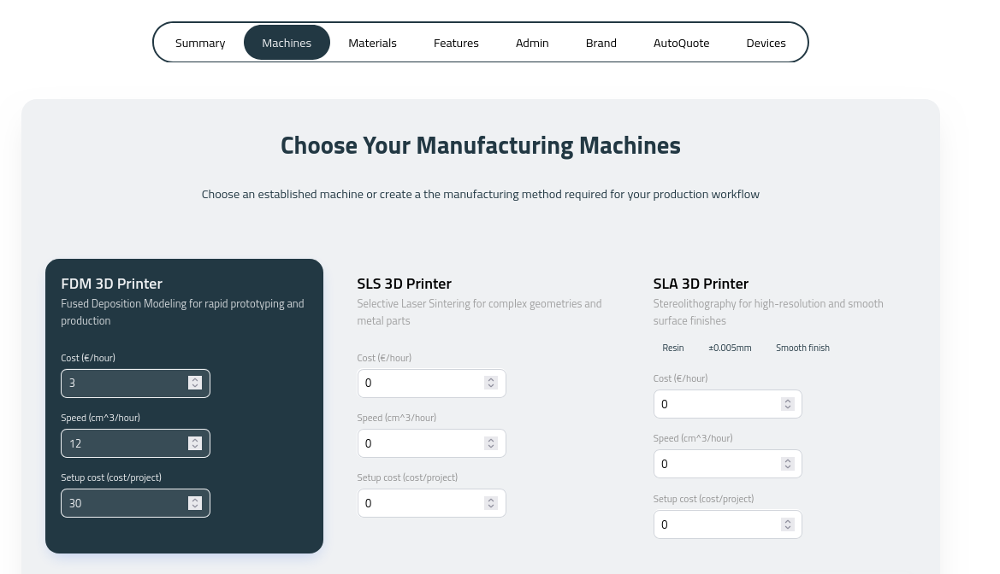
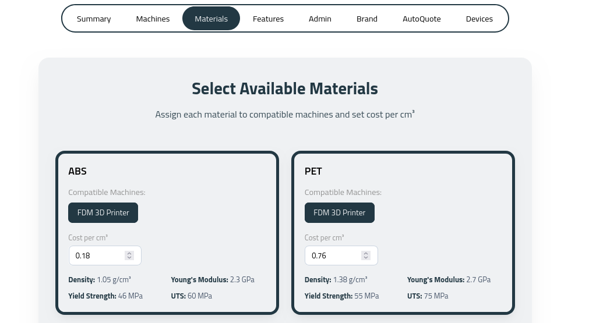
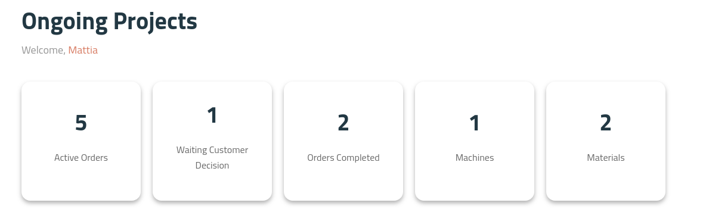

Once you start setting up your factory, two pieces of information are required as a minimum:

- Machines
- Materials

These are indicated in orange on the dashboard below. One of each is the minimum needed for a working factory:

To have a functioning factory online via your CAD interface you need to define the following.

### Quick set up of machines

### Quick set up of materials

The CAD will then permit the following choices for your customer, and will turn off the warnings in the dashboard:

