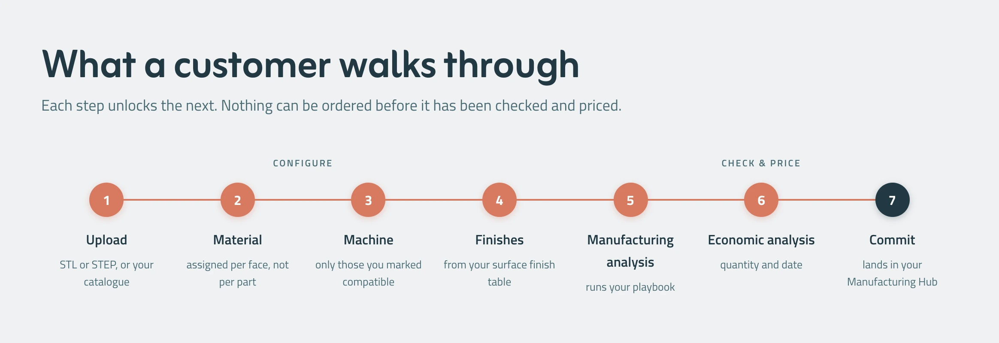

The online platform is a streamlined pipeline, where each step unlocks the next gradually, so a part cannot be ordered before it has been checked against your rules and priced against your costs.

### 1. Upload

The customer starts by uploading a CAD file, either as an STL or STEP format, or by selecting from your catalogue if the part already exists in your system.

### 2. Material

Materials are assigned per face rather than per part, meaning different surfaces or features of the same component can be assigned different materials where it is required.

Only machines that have been marked compatible with the part's geometry and requirements are shown as options, narrowing the choice to what's actually **viable**.

### 3. Finishes

Surface finish options are pulled from your finish table, so the customer only sees finishes you've configured as available.

### 4. Manufacturing Analysis

This is where your design playbook runs: all the rules and logic you've defined for feasibility, tolerancing, and producibility get applied here.

### 5. Economic Analysis

Based on the prior steps, the system calculates quantity-based pricing and delivery date.

### 6. Commit

The final step, where the order is confirmed and lands directly in your Manufacturing Hub for fulfillment.

In practice, that means the enquiries that you receive are the ones you can actually make, while the ones with flaws are dismissed via the online CAD. You spend your time reviewing work worth your time while skipping through requests that cannot be done effectively.
